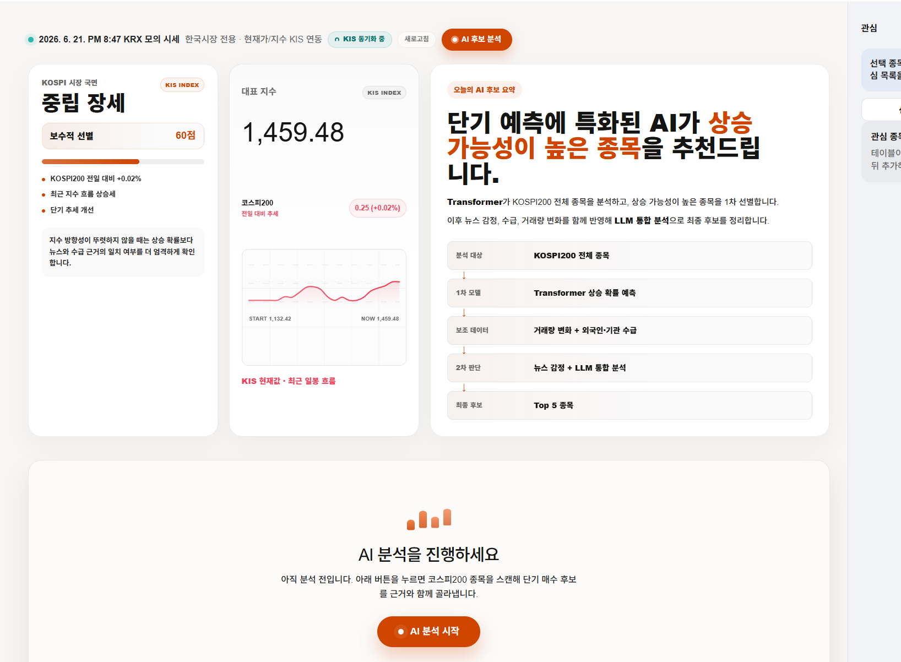
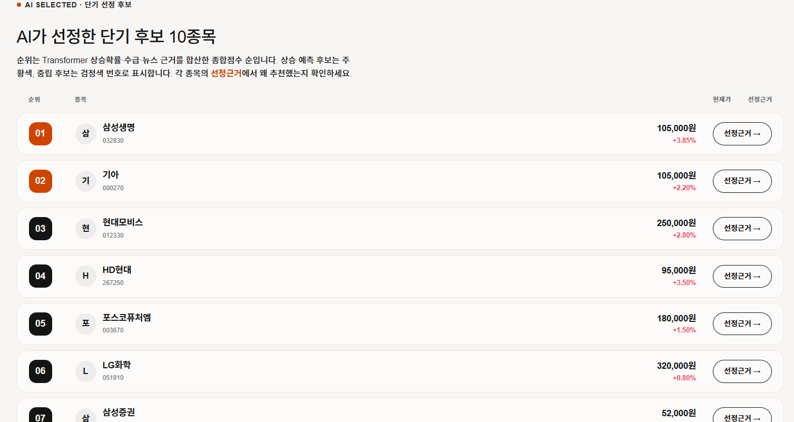
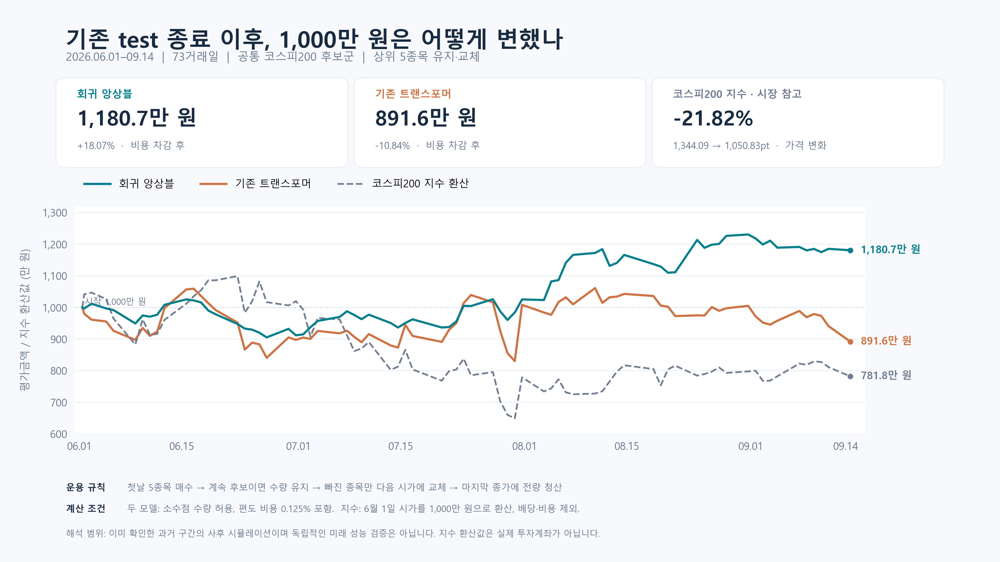

# 과거 Huber 모델 기록 — 현재 기본 모델 아님

아래 문서는 교체 전 README를 보존한 것입니다. 수익률·성능 수치를 새 순위 모델의 결과로 해석하지 않습니다. [현재 모델](../../README.md).

# KOSPI AI Trading Desk

KOSPI 종목의 **다음 거래일 시가→종가 예측수익률**과 관련 근거를 확인하는 연구용 대시보드입니다. 기본 가격 모델은 **Time2Vec + Linear 입력 투영을 쓰는 Transformer 3개의 Huber 회귀 앙상블**이며, 순위는 예측수익률 내림차순입니다. 현재 파이프라인은 Python `load_kospi200_pool()`로 구성한 KOSPI200 후보 풀을 추론 입력으로 사용합니다. 모델 manifest에는 학습 기간이 기록되어 있지만, 현재 후보 풀과 학습 대상 종목 집합이 같다고 단정하지 않습니다.

현재 웹 브리핑은 `model_only`로 모델 순위를 계산하고, 원본 순위 **TOP5에 대한 Google News RSS 관련 기사**를 수집해 표시합니다. 뉴스 본문 분석이나 뉴스 순위 보정은 적용하지 않으므로 브리핑 TOP5와 전체 순위는 가격 모델 순위입니다. 화면에서 브리핑(`/`), 전체 순위(`/rank`), 저장 실행·성과 이력(`/history`), 종목 리포트(`/stock/:code`)를 볼 수 있습니다. 관심 종목(`/watchlist`)과 서비스 소개(`/about`)도 제공하며 경로별 자세한 내용은 [프런트엔드 안내](../../FE/README.md)에 있습니다.

이 저장소는 동아대학교 컴퓨터공학과 4인 팀 프로젝트의 정량 모델·백테스트·검증을 중심으로 정리한 포크입니다. 실제 주문을 실행하는 투자 서비스가 아니며, 아래 과거 모의투자 결과와 웹에 저장되는 가격 성과는 실매매 수익을 뜻하지 않습니다.

## 현재 웹 실행 흐름

브리핑의 **분석 시작**은 모델 순위를 검증한 뒤 원본 순위 TOP5 관련 기사를 수집합니다. 기본 분류는 **수시 실행**이며, **공식 성과 기록 요청**을 선택해야 공식 집계 대상 실행으로 기록됩니다. 기본 실행 모드는 `model_only`이고 이 화면 경로에서는 뉴스 본문·감성 분석·LLM 호출·뉴스 보정 순위 생성을 하지 않습니다. 별도의 Python `integrated_pipeline.py --run-news`는 뉴스 사건을 추출하는 연구·내부 실행 경로입니다. 현재 검증 게이트가 비활성 상태라 뉴스 보정은 최종 점수에 적용되지 않습니다.

일반 후보·순위·실행 이력 GET은 결과 조회용이고 `POST /api/candidates/run`은 분석 실행, `POST /api/performance/collect`는 저장 실행의 실제 가격 수집을 시작합니다. 예약 작업용 인증 GET(`/api/performance/collect`, `/api/korean-market/refresh`)은 예외적으로 수집·갱신을 실행하며, 시세·시장 데이터 GET도 설정에 따라 KIS 외부 조회를 일으킬 수 있습니다. Vite의 `npm run preview`는 빌드된 정적 화면만 제공하며 API 미들웨어를 제공하지 않습니다. 웹 개발 API를 쓰려면 FE 개발 서버와 로컬 Python 파이프라인 설정이 필요합니다. API 경계와 연결 방법은 [FE 안내](../../FE/README.md)에 정리되어 있습니다.

### 뉴스 사건 보정 탐색 결과

다음 도식은 Python 연구 경로의 가격·뉴스 사건 결합 구조입니다. 현재 웹 브리핑의 RSS 기사 수집 흐름을 그린 그림은 아닙니다.

<p align="center"><a href="figures/price_news_architecture.svg"></a></p>

[가격 단독 vs 뉴스 추가 그래프](../images/figures/news_event_regime_comparison.png) · [상세 실험 보고서](docs/news_event_residual.md) · [팀원용 재현 가이드](research/regime_benchmark/REPRODUCE_KO.md) · [공개 실험 자료](research/regime_benchmark/published/)

| 구간 (별도 1,000만 원 시작) | 평가일 | 가격 단독 최종 자산 | 뉴스 사건 보정 최종 자산 | 가격/뉴스 Rank IC |
|---|---:|---:|---:|---:|
| 횡보 후반 | 5일 | **10,815,026원** | 10,469,450원 | 0.09437 / 0.08763 |
| 하락 | 10일 | **10,146,168원** | 9,977,358원 | 0.15872 / 0.14822 |
| 상승 | 10일 | **11,947,329원** | 11,480,769원 | -0.00145 / -0.01249 |

동일한 Top-5 보유·신규 종목만 교체 방식과 매수·매도 편도 0.125%를 적용했습니다. 이 세 기간은 이미 살펴본 구간이고 기사 원문의 당시 버전도 검증되지 않아 독립적인 미래 성능 증거가 아닙니다. 실험용 `event_fixed`와 실제 화면의 **게이트 적용 `event_gated`**를 구분해야 합니다. 게이트는 25개 평가일 중 0일 활성화됐습니다.

## 화면

| 대시보드 | 후보 랭킹 |
|---|---|
|  |  |

위 화면은 기존 분류 모델 버전의 디자인 참고 이미지입니다. 현재 코드는 회귀 **예측수익률**을 표시하며, 기존 화면의 상승확률 수치를 새 모델 결과로 사용하지 않습니다.

## 뉴스 연구 기록과 한계

아래 실험은 기존 구간을 사용한 연구 기록이며, 현재 웹의 `model_only` 브리핑이나 독립적인 미래 성능 증거가 아닙니다. Python `--run-news`의 사건 분석·게이트 경로와 과거 초기 뉴스 실험은 별개입니다.

<details>
<summary>뉴스 결합·보정 실험 기록 보기</summary>

뉴스 결합 연구의 초기 경로는 [뉴스 결합 파이프라인](docs/news_fusion.md)에 있습니다. Gemini는 기사 감정·사건·근거 추출을 담당하고, 작은 Ridge 결합 모델의 보정 후보는 검증 게이트가 꺼져 있어 최종 점수에 적용되지 않습니다. 본문 확보 실패를 제목으로 대체하지 않습니다. 별도 연구 실행기로 10거래일 가격 단독 / 고정 뉴스 악재 필터를 비교했을 때 두 전략의 Top-5가 같아 투자 결과도 같았습니다. 이는 학습형 뉴스 결합 모델 검증이 아닙니다.

후속 [근거 제한 뉴스 보정 실험](docs/news_guarded.md)에서는 기존 Huber 예상수익률에 검증된 기업 사건 뉴스만 최대 ±10bp로 반영하고, 매매비용을 넘는 경우에만 종목을 교체하는 규칙을 추가했습니다. 기존 세 시장 구간에서 비용 기준 교체는 두 구간 개선·한 구간 악화였고 전체 종목 Rank IC 개선은 확인되지 않았습니다. 기존 기간을 재사용한 탐색 결과이며 웹 서비스의 뉴스 선정 기능을 자동 교체하지 않습니다.

[뉴스 결합 반복 실험 보고서](docs/news_experiments.md)는 사건 유형 선형·트리 결합, 의미 오류 필터, 기사 제목 직접 학습을 날짜 순서대로 비교합니다. 앞선 30일에서 일관된 예측 개선은 없었고, 별도 2026-09-15~23의 7거래일 제목 모델도 가격 단독보다 높은 투자 성과를 보이지 않았습니다. 과거 기사 검색은 시점별 원문 아카이브가 아니므로 독립적인 뉴스 백테스트로 해석할 수 없습니다.

2026-09-26 [논문 기반 뉴스 추가 예측력 연구](docs/news_research_conclusion.md)는 공개 E5 제목·본문 표현과 두 종류의 가격 오차 보정 목표를 비교했습니다. 본문 의미를 넣은 작은 Rank IC 상승은 기사 내용 없이 본문 유무만 넣은 대조군보다 작았습니다. 날짜별 수집 계획 밖의 본문 사용 문제를 발견해 수정 재실험했으며, 개선된 서비스 전략을 채택할 근거는 아직 없습니다. [연구 설계·출처](docs/news_research_design.md), [모든 순위 보정 결과](docs/news_residual_results.md)를 함께 공개합니다.

상승·하락·횡보 구간의 입력·날짜·결과 검증은 [한국어 재현 가이드](research/regime_benchmark/REPRODUCE_KO.md)를 참고하세요. 이번 뉴스 실험의 사건 라벨은 본문을 제거해 공개했고, 필요한 전체 시세와 기사 원문은 추가로 올리지 않았습니다. 저장소의 `docs/validation/daily_bars.parquet`는 이번 실험 필요 행 중 1,761개가 부족해 단독 재현에는 쓸 수 없습니다.

</details>

## 모델 교체 내용

| 항목 | 기존 모델 | 현재 기본 모델 |
|---|---|---|
| 입력 | 20거래일 × 11개 지표 | 동일한 20 × 11개 지표 |
| 입력 투영 | Time2Vec + 시간축 Conv1D | Time2Vec + 일자별 Linear |
| 예측기 | Transformer 1개 | Transformer 3개, seed 42·43·44 |
| 목적 | 익일 종가 방향 분류 | 다음 거래일 시가→종가 수익률 회귀 |
| 손실 | 분류 손실 | 학습 수익률 표준화 후 Huber 손실 |
| 출력 | 상승확률 P(up) | 각 모델 출력 역정규화 후 수익률의 산술평균 |
| 순위 | 상승확률 내림차순 | 예측수익률 내림차순, 동점이면 종목코드 순 |

`0.012`는 **예측수익률 +1.2%**입니다. 상승확률 1.2%가 아니며 sigmoid나 0.5 임계값을 적용하지 않습니다. 앙상블은 같은 구조를 서로 다른 seed로 학습한 세 모델입니다.

Conv 없는 구조로 이미 재학습하고 비교한 **확정 가중치**를 옮겼습니다. 이번 교체 과정에서 추가 학습이나 튜닝은 하지 않았습니다. 체크포인트와 스케일러 출처·SHA-256은 [모델 manifest](https://github.com/dan6396/deep-learning-stock-trading/blob/40c3d200018861ba9f99e87fd6f285949d9267b2/models/huber_ensemble/manifest.json)에 있습니다.

## 빠른 실행 — API 키 없이 확인

Python 3.10 이상이 필요합니다. 이번 검증 환경은 Python 3.13, PyTorch 2.12 CPU, NumPy 2.4.6, pandas 2.3.3, PyArrow 24.0입니다. 의존성 파일의 모든 버전 조합을 검사한 것은 아닙니다.

```bash
pip install -r requirements-inference.txt
python verify_ensemble.py
python predict.py --data tests/fixtures/ensemble/raw_ohlcv.parquet --ticker 005930 --as-of 2026-09-11
```

기본 경로는 `models/huber_ensemble/manifest.json`입니다. 모델 3개와 스케일러가 포함되어 별도 다운로드나 재학습이 필요 없습니다. `--as-of`는 입력의 마지막 날짜를 제한합니다. 제공 자료는 과거 재현용이며 최신 시세가 아닙니다.

```python
from ensemble import DEFAULT_MANIFEST
from predict import predict_multiple

# 각 DataFrame: 단일 종목, 일별 DatetimeIndex, Open/High/Low/Close/Volume
# 반드시 장이 끝난 날짜까지만 입력하며 충분한 과거 이력을 함께 제공
scores, errors = predict_multiple(
    str(DEFAULT_MANIFEST), ticker_dfs, return_errors=True,
)
# scores: 예측수익률 내림차순. 실패 종목은 NaN, 원인은 errors에 기록.
```

입력 지표는 과거 데이터만으로 계산하며 학습 당시 스케일러를 그대로 적용합니다. 지표 준비 구간을 위해 60행 이상을 권장하고, 지수이동평균 초기값 영향을 줄이려면 가능한 긴 이력을 제공합니다. 추론 중 정규화 값을 새로 학습하지 않습니다.

## 아키텍처

상단 [전체 구조도](../images/figures/price_news_architecture.svg)에 가격·뉴스 두 경로와 게이트 상태를 표시했습니다. 가격 경로 내부는 20거래일 × 11개 지표 → 학습 시 스케일러 → Time2Vec + Linear → Transformer 회귀 모델 3개 → 예측수익률 평균입니다.

수급은 후보에 참고 정보를 붙입니다. 아래 73일 수익률 검증에는 수급 필터나 뉴스를 적용하지 않았습니다. 화면에서 뉴스 보정 여부와 원래 가격 예측 순위를 구분해 표시합니다.

## 1,000만 원 비교 결과

기존 test 마지막 거래일 **2026-05-29 이후**, **2026-06-01~2026-09-14의 73거래일**을 비교했습니다. 같은 일별 199~200개 후보, 같은 가격과 거래 규칙을 적용했습니다.



| 지표 | 기존 분류 Transformer | 채택한 회귀 앙상블 |
|---|---:|---:|
| 시작 자산 | 10,000,000원 | 10,000,000원 |
| 최종 자산 | 8,916,409원 | **11,807,394원** |
| 순손익 | −1,083,591원 | **+1,807,394원** |
| 비용 차감 후 수익률 | −10.84% | **+18.07%** |
| 최대 낙폭(MDD) | 21.62% | **11.72%** |
| 누적 거래비용 | 1,353,100원 | 424,781원 |
| 매수 / 매도 건수 | 280 / 280 | 80 / 80 |

매매 규칙:

1. 전 거래일 종가까지의 데이터로 다음 거래일 후보 5개를 선정합니다.
2. 첫날 시가에 5개를 모두 매수합니다.
3. 다음 후보에도 남은 종목은 **기존 수량 그대로 보유**합니다. 제외된 종목만 다음 시가에 팔고, 현금을 신규 후보에 균등 배분합니다.
4. 매수·매도 각각 거래대금의 **0.125%**를 차감하고 마지막 날 종가에 전량 청산합니다.

첫 5종목을 모두 살 수 있도록 **소수점 주식을 허용한 이론적 시뮬레이션**입니다. 정수 주식 주문·시장가 체결을 보장하는 실거래 결과가 아닙니다. 보유를 유지하므로 야간 가격 변동도 손익에 포함되지만, 모델의 학습 목표는 하루의 시가→종가 수익률입니다.

KOSPI200 가격지수는 첫날 시가 1,344.09에서 마지막 날 종가 1,050.83으로 **−21.82%**였습니다. 시장 선은 같은 시작금액으로 환산한 가격지수이며, 배당·거래비용·ETF 추적 오차를 반영한 투자 수익률은 아닙니다.

`python verify_ensemble.py`는 14,583개 고정 입력에서 새 코드로 추론하고 73일 Top-5 순위와 두 포트폴리오 원장을 재검산합니다. 이동 검증에서 예측수익률 최대 절대 오차는 `8.89e-9`, Top-5 순위는 전부 일치했습니다. [검증 기록](docs/validation/README.md)을 참고하세요.

## 학습 구간과 해석의 한계

| 용도 | 기간 |
|---|---|
| 학습 | 2023-03-01~2026-02-27 |
| 검증·체크포인트 선택 | 2026-03-02~2026-05-29 |
| 위 모의투자 평가 | 2026-06-01~2026-09-14 |

학습·검증은 시간으로 분리했고 구간 끝을 넘어가는 수익률 라벨을 제외했습니다. 다만 **평가 결과를 이미 보고 모델과 보유 규칙을 채택했으므로, 위 결과는 독립적인 최종 test나 미래 실전 성과가 아닙니다.** 이 기간에서 앙상블이 나았다는 근거이며 다른 시장·기간의 우월성을 보장하지 않습니다. 과거 구성종목의 완전한 시점별 복원이 아니어서 생존편향 가능성이 있고, 조정주가·이상적인 체결·고정 거래비용을 가정합니다.

기존 README의 방향정확도 56.26%·수익률 +78.11%는 **이전 분류 모델의 다른 기간·종목·매매 가정**에 대한 기록입니다. 종목별 분리만으로 미래 검증이 되지는 않으므로 현재 성능과 나란히 비교하지 않습니다. 이전 계산은 `python verify_results.py`에 남겨 두었습니다.

## 후보 분석과 화면 실행

Python 3.10 이상과 FE 개발 환경이 필요합니다. 로컬 파이프라인을 실행할 때는 Python 의존성을 설치하고 본인 실행 환경에 KIS 설정을 제공합니다. 프런트엔드 API 서버는 프로젝트 루트와 `outputs` 결과 파일에 접근할 수 있어야 합니다. 비밀 값이나 개인별 경로는 저장소 문서에 넣지 마세요.

저장소 루트에서 기본 가격 모델 파이프라인을 실행합니다.

```powershell
python -m pip install -r requirements.txt -r requirements-news.txt
python integrated_pipeline.py
```

FE 개발 서버는 별도 터미널에서 실행합니다.

```powershell
Set-Location FE
npm ci
npm run dev -- --host 127.0.0.1
```

별도의 Python 뉴스 사건 연구·내부 경로를 실행하려면 저장소 루트에서 필요한 뉴스/Gemini 설정을 준비한 뒤 선택적으로 실행합니다. 이는 웹 브리핑의 RSS 관련 기사 수집과 다릅니다.

```powershell
python integrated_pipeline.py --run-news
```

FE 실행 디렉터리에서 제공되는 검증 명령은 `npm test`, `npm run typecheck`, `npm run build`, `npm run verify:a11y`입니다. API 없이 빌드된 화면만 확인하려면 `npm run preview`를 쓸 수 있지만, preview는 정적 화면 서버여서 API를 제공하지 않습니다. 개발 API 연동에는 Vite 개발 서버 또는 별도 API 서버가 필요합니다.

Python 파이프라인의 기본 최종 선정 수는 5개이며 후보 풀 기본 크기는 200개입니다. `--final-max 10`은 별도 후보 구성 설정입니다. 이 설정으로 바꾼 결과에 앞서 제시한 Top-5 과거 수익률을 그대로 적용할 수 없습니다. 장중 실행은 KST 16시 이전 당일 봉을 제외합니다. 공통 마지막 날짜에 거래 자료가 없거나 거래 정지 상태인 종목은 순위에서 제외합니다. 데이터 지연·구성종목 복원 여부는 별도 확인이 필요합니다.

FE 서버는 기본적으로 새 manifest를 사용합니다. 경로를 바꾸려면 `PIPELINE_MODEL_MANIFEST`를 설정합니다. 기존 `PIPELINE_TRANSFORMER_CKPT` 환경변수는 사용하지 않습니다. 웹의 분석 시작은 뉴스 본문 분석이 아니라 `model_only` 모델 순위 실행과 TOP5 RSS 기사 수집입니다. `--run-news`는 별도 Python 연구·내부 경로이며 웹 브리핑 실행과 다릅니다. GitHub 코드 반영만으로 실행 중인 Python 서버나 웹 호스팅이 자동 배포되는 것은 아닙니다.

저장 성과 집계는 공식 요청으로 분류된 실행 중 검증 조건을 충족한 기록을 모읍니다. 수시 실행은 공식 집계에서 제외됩니다. 집계 수익률은 선정 종목의 동일 비중 시가→종가 가격 변동이며 거래비용·주문 체결을 반영한 실매매 손익이 아닙니다. API 동작은 [API 계약 문서](../../FE/docs/api-contract.md)와 [프런트엔드 안내](../../FE/README.md)를 참고하세요.

`step2_all_transformer_rank.csv`, `step2_final_top10.csv` 등 파일명은 기존 연동을 위해 유지합니다. 내용은 `ensemble_pred_return`, `prediction_base_date`, `prediction_target`, `model_id` 기준이며 새 모델은 `p_up`을 생성하지 않습니다. [API 변경 사항](../../FE/docs/api-contract.md)을 참고하세요.

## 구조

가격 후보와 독립 뉴스 후보를 합치는 비용 제한 실험은 [뉴스 결합 효율 비교](docs/news_efficiency.md)를 참고하세요.
후보 구성·대표 기사 수·뉴스 비중에 따른 12개 조합을 기존 투자 엔진으로 비교하며,
이미 관찰한 10거래일의 탐색 실험입니다. 기존 서비스 기본 전략을 자동 변경하지 않습니다.

```text
ensemble.py                    Conv 없는 회귀 모델과 3개 모델 로더
models/huber_ensemble/         확정 가중치·스케일러·출처 manifest
predict.py                     기본 앙상블 추론, 명시적 .pt는 과거 모델 추론
data.py / model.py             공통 지표 및 과거 모델 구조 보존
verify_ensemble.py             예측·순위·포트폴리오 오프라인 검증
portfolio_replay.py            보유 유지·신규 종목 교체 원장 재생
tests/fixtures/ensemble/       고정 입력·예측 참조·원시 데이터 일부
docs/validation/               투자 비교 자료와 한계
verify_results.py              이전 분류 모델 결과 재현
integrated_pipeline.py         후보 수집·회귀 순위·수급 첨부
crolling.py                    뉴스·Gemini 설명
FE/                           React + Vite 대시보드
```
