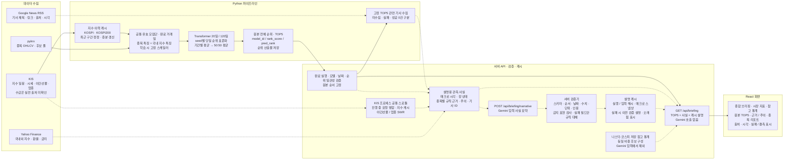

# 시스템 구성도 · 순위 산출과 설명 생성의 분리

현재 동작 기준은 [루트 README](../../../../README.md), [모델 manifest](../../../../models/final_rank_ensemble/manifest.json), [API 계약](../../../../FE/docs/api-contract.md)이다. 과거 [서비스 설계 문서](../../SERVICE_ARCHITECTURE_DESIGN.md)의 상승확률·뉴스 결합 순위·Naver 경로를 현재 구조로 옮기지 않는다.

**실선:** 모델 입력 → 고정 순위 → 검증 → 화면의 순위 경로. **점선:** 수집 사실 → 설명·검증·캐시 → 화면의 설명 경로다. 외부 데이터 수집 자체가 모델 재학습이나 재정렬을 뜻하지 않는다. 설명 경로에서 Transformer나 원본 순위로 되돌아가는 연결은 없다.

국내 KOSPI·KOSPI200의 과거 특징은 이미 모델 입력에 들어간다. 추가 매크로 관측·최신 RSS 기사·Gemini 설명을 원본 순위 점수에 더하지 않는다는 의미다. 모델 기간·결합 가중치 근거: [manifest](../../../../models/final_rank_ensemble/manifest.json). 고정 TOP5·기사·검증 경로 근거: [API 계약](../../../../FE/docs/api-contract.md).

KIS 이력 캐시는 Python 경로이고 스로틀·SWR는 Node 경로다. 이 그림의 Node 공통 스로틀이 Python·다른 프로세스까지 합산 제어한다는 의미는 아니다. 업종은 미확인 시 null이고 수급 실전 출처는 별도 확인이 남아 있다. 근거: [API 계약](../../../../FE/docs/api-contract.md), [업종 진단](../sector-diagnostic.json), [이번 검증 한계](../README.md).

포스터 캡션: **모델 순위는 고정하고, 설명은 출처·시각·검증 결과와 함께 제공한다.** 수집·화면 연결의 동작 검증과 모델의 미래 예측 성능 검증을 구분한다.
